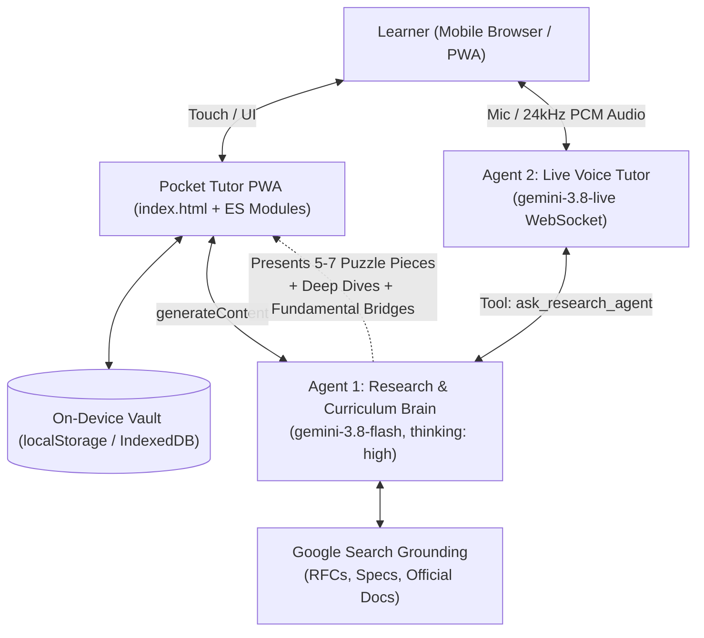

# Pocket Tutor (`micro-learning`): Master Project Knowledge Base

This document serves as the permanent master reference for the **Pocket Tutor** (`micro-learning`) architecture, system design, API contracts, operational runbooks, and file structures.

---

## 1. Executive Summary & Architecture Overview

- **Project Goal:** Pocket Tutor is a mobile-first, zero-build Progressive Web App (PWA) for personalized micro-learning. It runs 100% client-side on the user's phone via GitHub Pages using a Bring-Your-Own-Key (BYOK) Gemini API architecture.
- **Core Technology Stack:** Vanilla JavaScript (Native ES Modules), Tailwind CSS (CDN), HTML5 Web Audio API, WebSocket (`BidiGenerateContent`), Google Gemini 3.8 Flash & Live APIs.
- **Deployment & Hosting Model:** GitHub Pages hosted from the `master` branch root (`https://eitama.github.io/micro-learning/`) with zero build step (no npm/Node build required).



---

## 2. Key Decisions & Rationale

| Decision Area | Choice Made | Rationale & Trade-offs |
| :--- | :--- | :--- |
| **Architecture / Hosting** | Pure Zero-Build Static PWA (GitHub Pages) | Zero server maintenance cost, instant deployment on git push, works directly in mobile browsers and as an installable standalone PWA. |
| **Key & Privacy Model** | Bring Your Own Key (BYOK) | API keys stay exclusively in the user's mobile browser `localStorage`. No telemetry, no backend proxy, complete data ownership. |
| **Code Structure** | Native ES Modules (`type="module"`) | Prevents massive unmaintainable single-file truncation bugs while preserving zero-build requirements. Cleanly separates UI, API, Live WebSocket Audio, and Vault Storage. |
| **Research Grounding** | Official Docs / Specs Priority via `google_search` | Filters out generic SEO blogs in favor of RFCs, GitHub specifications, MDN, standard specs, and official framework docs. |
| **Voice & Live Audio** | Bidirectional WebSocket (`BidiGenerateContent`) + Web Audio API | Low-latency voice interaction with barge-in support. Agent 2 can call Agent 1 (`ask_research_agent`) for grounded deep dive answers. |
| **Persistence** | LocalStorage + IndexedDB (`PT38_VAULT_MIRROR`) with JSON Export/Import | Resilient multi-tier client persistence allowing full offline course review and data backups. |

---

## 3. Environment, Infrastructure & Credentials

> [!CAUTION]
> Never commit raw API keys to GitHub. Pocket Tutor is client-side BYOK: keys are entered by the user via the in-app Config modal and stored in browser `localStorage`.

### Services & Infrastructure Inventory
- **GitHub Repository:** `https://github.com/eitama/micro-learning`
- **Git SSH Remote:** `git@github-eitama:eitama/micro-learning.git` (uses `~/.ssh/id_ed25519_eitama` via `~/.ssh/config`)
- **Live Production URL:** `https://eitama.github.io/micro-learning/`
- **Default Branch:** `master`

### Config Keys & Local Storage Items
- `PT38_API_KEY`: User's Gemini API key (entered in Config modal).
- `PT38_RESEARCH_MODEL`: Target model for Agent 1 (Default: `gemini-3.8-flash`, fallback configurable).
- `PT38_THINKING_LEVEL`: Reasoning effort for Agent 1 (`high`, `medium`, `low`).
- `PT38_LIVE_MODEL`: Target model for Agent 2 (Default: `gemini-3.8-live`).
- `PT38_VOICE_NAME`: Gemini Live voice persona (`Aoede`, `Puck`, `Kore`, `Charon`, `Fenrir`).
- `PT38_VAULT_MIRROR`: Master JSON record storing courses, puzzle pieces, source registries, Q&A history, learner narratives, and fundamental suggestions.

---

## 4. Operations & Maintenance Runbook

### Prerequisites & Local Testing
To test locally with live reload or simple HTTP server:
```bash
# Install dependencies
npm install

# Run full test suite (E2E Headless Chrome + Unit tests with Mock Gemini Server)
npm test

# Serve locally
npm run serve
# Or with Python:
python -m http.server 8080
```

### Git Deployment Workflow
```bash
git add .
git commit -m "feat/fix: description of changes"
git push origin master
```
Changes are automatically deployed to `https://eitama.github.io/micro-learning/` within 1–2 minutes via GitHub Pages.

### Mobile Audio & WebSocket Notes
- iOS Safari and Android Chrome require an explicit user gesture (`click` or `touchend`) to unlock the Web Audio `AudioContext`. The Live Session Start button serves as this gesture.
- Live WebSockets connect to: `wss://generativelanguage.googleapis.com/ws/google.ai.generativelanguage.v1alpha.GenerativeService.BidiGenerateContent?key=${apiKey}`.
- Model names can be customized in the in-app settings if new Gemini preview aliases are made available.

---

## 5. Financial & Safety Guardrails

- **Zero Host Costs:** Completely static, free GitHub Pages hosting.
- **Token / Cost Transparency:** User consumes their own Google AI Studio quota; no shared backend budget.
- **Fail-safe Error Reporting:** Global `window.onerror` and `window.onunhandledrejection` banners show clear, readable diagnostics on mobile without needing USB debugging.

---

## 6. Workspace Files & Entry Points

| File / Directory | Purpose |
| :--- | :--- |
| `index.html` | Application shell, mobile responsive layout, PWA manifest, and modal dialogs. |
| `js/app.js` | Main application coordinator, event listeners, UI rendering, tab navigation. |
| `js/gemini-api.js` | Agent 1 implementation: research generation, official source filtering, deep dives, learner narrative, and bridge analysis. |
| `js/live-audio.js` | Agent 2 implementation: Gemini Live WebSocket client, microphone capture (16kHz PCM), audio playback (24kHz PCM), and tool calling loop. |
| `js/storage.js` | Data persistence layer: `localStorage` / IndexedDB management, export/import JSON handlers. |
| `AGENTS.md` | Dual-agent design specification and technical requirements. |
| `KNOWLEDGE_BASE.md` | Master project knowledge base and operational runbook. |
| `README.md` | Repository overview and quick start guide. |
| `package.json` | Project scripts and development test dependencies. |
| `test/mock-gemini-server.js` | Mock Gemini REST & WebSocket server for local offline testing. |
| `test/app.test.js` | E2E headless Chrome test suite covering all UI flows and Live Audio. |
| `test/storage.test.js` | Unit tests for vault state management and JSON export/import. |
| `test/gemini-api.test.js` | Unit tests for JSON extraction and API error resiliency. |
